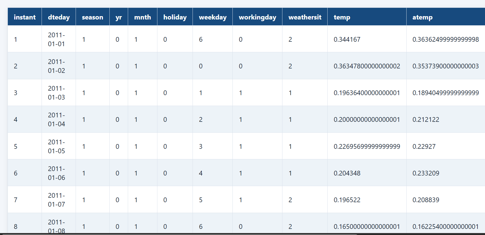
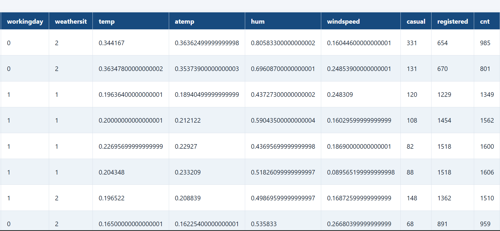
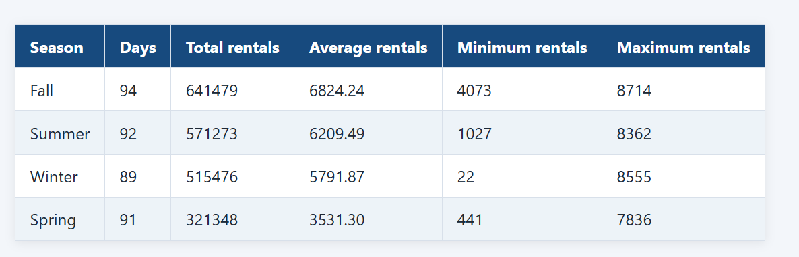

# DataTable

DataTable is a modular C++17 library for storing, inspecting, transforming,
formatting, and exporting small tabular data sets. The project uses one shared
`DataTable` representation across all modules so that rows, columns, and typed
cells remain consistent.

## Table of contents

1. [Project status](#project-status)
2. [Implemented features](#implemented-features)
3. [Architecture](#architecture)
4. [Supported values](#supported-values)
5. [Requirements](#requirements)
6. [Build and test](#build-and-test)
7. [Usage](#usage)
8. [API overview](#api-overview)
9. [Validation and error handling](#validation-and-error-handling)
10. [Design and memory behavior](#design-and-memory-behavior)
11. [Examples](#examples)
12. [Reports](#reports)
13. [Limitations](#limitations)
14. [Team ownership](#team-ownership)
15. [Contributing](#contributing)
16. [AI use declaration](#ai-use-declaration)
17. [License](#license)

## Project status

The library modules, integration workflow, examples, and CMake build are
implemented. The test suite registers 12 module tests plus 7 executable-example
smoke tests covering the data model, transformations, formatting, styling,
export, and end-to-end usage.

The project is developed as a group assignment. Each contributor owns a
module, while `DataTable` is the shared integration boundary.

## Implemented features

- Typed cells containing null, boolean, signed integer, unsigned integer,
  double, or string values.
- `Row` and `Column` data-model classes with ownership and bounds validation.
- Central `DataTable` storage for schema, rows, and columns.
- Explicitly typed or type-inferred homogeneous columns; null cells are
  accepted without changing a column's value type.
- Row insertion, update, removal, table clearing, column lookup, and
  synchronized row replacement.
- CSV parsing into string records.
- CSV loading into a typed `DataTable`.
- Missing CSV fields represented as null cells.
- Validation of malformed CSV quoting and inconsistent row widths.
- Stable ascending and descending sorting by column.
- Filtering columns or complete tables using predicates or equality.
- Grouping by column while preserving first-seen key order.
- Counting, sum, mean, minimum, and maximum aggregation.
- Console formatting with headers, borders, alignment, padding, and
  automatically calculated widths.
- CSV export of headers and row values with CSV escaping.
- Complete HTML export with escaped headers and row values.
- CMake installation and package target generation.
- Focused module tests and full CTest validation.

## Architecture

The library is organized around a shared table model:

```text
DataTable
├── Row
│   └── Cell
└── Column
    └── Cell
```

`DataTable` owns the table schema, rows, and columns. `Row` owns an ordered
sequence of `Cell` objects, and `Column` owns a name and an ordered sequence
of `Cell` objects. Table operations use these objects instead of creating
separate table representations.

```text
CSV parser ──> DataTable::fromCsv()
                     │
       ┌─────────────┼─────────────┐
       ▼             ▼             ▼
   sorting       filtering      grouping
       │             │             │
       └─────────────┼─────────────┘
                     ▼
               aggregation
                     │
          ┌──────────┴──────────┐
          ▼                     ▼
      formatting              export
```

### Repository layout

```text
DataTable/
├── CMakeLists.txt
├── LICENSE
├── README.md
├── cmake/
│   └── DataTableConfig.cmake.in
├── include/datatable/
│   ├── aggregate.hpp
│   ├── cell.hpp
│   ├── column.hpp
│   ├── csv.hpp
│   ├── export.hpp
│   ├── filter.hpp
│   ├── formatter.hpp
│   ├── group.hpp
│   ├── row.hpp
│   ├── sort.hpp
│   ├── style.hpp
│   └── table.hpp
├── src/
│   └── *.cpp
├── tests/
│   ├── CMakeLists.txt
│   └── test_*.cpp
├── examples/
│   ├── CMakeLists.txt
│   ├── basic_table.cpp
│   ├── csv_example.cpp
│   ├── filtering_example.cpp
│   ├── grouping_example.cpp
│   ├── export_example.cpp
│   ├── integration_example.cpp
│   └── performance_example.cpp
├── reports/
│   ├── README.md
│   ├── General-Report.md
│   ├── Final-Presentation.md
│   ├── week-01/
│   ├── week-02/
│   ├── week-03/
│   ├── week-04/
│   └── final/
└── .github/workflows/
    └── build.yml
```

The `build/` directory is generated locally by CMake and is not part of the
source layout.

## Supported values

`CellValue` is defined as:

```cpp
std::variant<
    std::monostate,  // null
    bool,
    std::int64_t,
    std::uint64_t,
    double,
    std::string
>
```

Empty CSV fields become null cells. CSV type inference recognizes exact
`true` and `false`, signed and unsigned integer values that fit the supported
ranges, and decimal values representable as `double`. Fields with leading or
trailing whitespace remain strings rather than being silently trimmed.

## Requirements

- C++17-compatible compiler.
- CMake 3.20 or newer.
- Git for source retrieval.
- A supported build toolchain, such as MSVC, GCC, or Clang.

The project has no third-party runtime dependency. Tests use the C++ standard
library and `assert`; they do not require an external test framework.
Assertions remain enabled in Release test builds so test checks are not
silently removed by `NDEBUG`.

## Build and test

From the repository root:

```bash
cmake -S . -B build
cmake --build build
ctest --test-dir build --output-on-failure
```

For a Release build on a multi-configuration generator:

```bash
cmake --build build --config Release
ctest --test-dir build -C Release --output-on-failure
```

The registered tests include the module tests and executable examples.

To include examples, leave the default CMake option enabled:

```bash
cmake -S . -B build -DDATATABLE_BUILD_EXAMPLES=ON
cmake --build build
ctest --test-dir build --output-on-failure
```

To build without tests or examples:

```bash
cmake -S . -B build \
  -DDATATABLE_BUILD_TESTS=OFF \
  -DDATATABLE_BUILD_EXAMPLES=OFF
```

## Usage

The following example uses the implemented public API:

```cpp
#include <iostream>
#include <cstdint>
#include <sstream>

#include "datatable/export.hpp"
#include "datatable/formatter.hpp"
#include "datatable/filter.hpp"
#include "datatable/sort.hpp"
#include "datatable/table.hpp"

int main()
{
    std::istringstream input(
        "Name,Department,Score\n"
        "Ada,Engineering,98.5\n"
        "Grace,Support,91.0\n"
        "Lin,Engineering,96.0\n"
    );

    datatable::DataTable table = datatable::DataTable::fromCsv(input);

    datatable::DataTable engineering =
        datatable::filterEquals(table, 1, datatable::Cell("Engineering"));
    datatable::sortByColumn(engineering, 2);

    std::cout << datatable::formatTable(engineering);
    datatable::write_csv(engineering, std::cout);
}
```

`sortByColumn()` changes the row order of the supplied table. Filtering
returns a new table and leaves its source unchanged. Formatting and export
read the table without changing it.

## API overview

### Table and data model

```cpp
datatable::DataTable table;
table.addColumn("Name", datatable::CellType::string);
table.addColumn("Age", datatable::CellType::signed_integer);
table.addRow(datatable::Row{"Ada", 36});
table.updateRow(0, datatable::Row{"Ada Lovelace", 36});
table.removeRow(0);

table.rowCount();
table.columnCount();
table.column("Name");
table.column("Age").type(); // std::optional<CellType>
table.rows();
table.columns();
```

`addColumn(name, CellType)` declares a column's value type. `addColumn(name)`
infers it from the first non-null cell. Columns accept null values but reject
any non-null value with a different type. Table columns are exposed read-only;
`updateRow()` is the supported way to change table data while preserving the
row/column views.

### CSV

```cpp
datatable::CsvData records = datatable::parseCsv(input);
datatable::DataTable table = datatable::DataTable::fromCsv(input);
```

`parseCsv()` returns string records only. `DataTable::fromCsv()` performs
typed-cell conversion and validates the table schema. Non-null values in one
column must have the same `CellType`; null fields are accepted for every
column. Mixed-type CSV columns are rejected rather than silently coerced.

### Sorting and filtering

```cpp
datatable::sortByColumn(
    table,
    1,
    datatable::SortOrder::descending
);

datatable::DataTable selected =
    datatable::filterByColumn(table, 1, [](const datatable::Cell& cell) {
        return cell.holds<std::int64_t>() && cell.get<std::int64_t>() >= 30;
    });
```

### Grouping and aggregation

```cpp
const auto groups = datatable::groupBy(table, 1);
const std::size_t rows_with_values = datatable::count(table, 2);
const double total = datatable::sum(table, 2);
const double average = datatable::mean(table, 2);
```

Numeric aggregation ignores null cells and rejects unsupported non-null
values.

### Formatting and export

```cpp
datatable::Style style;
style.setAlignment(datatable::Alignment::right);
std::cout << datatable::formatTable(table, style);

datatable::write_csv(table, output);
datatable::write_html(table, output);
```

CSV and HTML export include headers and all rows. HTML text is escaped before
being written.

## Validation and error handling

The library reports invalid input explicitly:

- Invalid row widths raise `std::invalid_argument`.
- Empty or duplicate column names raise `std::invalid_argument`.
- Invalid row or column indexes raise `std::out_of_range`.
- Non-null values that do not match an established or declared column type
  raise `std::invalid_argument`; null values are accepted by every column.
- Incorrect typed `Cell` access raises `std::bad_variant_access`.
- Null C-string values are rejected.
- Malformed CSV quoting raises `std::invalid_argument`.
- CSV records with the wrong number of fields raise `std::invalid_argument`.
- Non-EOF CSV read failures raise `std::ios_base::failure`.
- Failed export streams raise `std::ios_base::failure`.
- Aggregation of unsupported non-null values raises
  `std::invalid_argument`.

## Design and memory behavior

The library uses value-owning standard containers and RAII:

- `Cell` owns its `CellValue`.
- `Row` owns `std::vector<Cell>`.
- `Column` owns its name and `std::vector<Cell>`.
- `DataTable` owns its schema, rows, and columns.

Move operations are explicitly available for the data-model classes. Public
read-only access returns references where appropriate to avoid unnecessary
copies. Operations that produce a new result, such as filtering, make an
independent table by design. Sorting reorders complete rows and rebuilds the
column view so values from one record remain together.

The `performance_example` reports CSV loading, filtering, sorting,
grouping/aggregation, and CSV/HTML export timings for 1,000, 10,000, and
100,000 rows. It is an in-memory smoke benchmark, not a statistically rigorous
or cross-library comparison; results depend on the build, platform, and
machine load.

## Examples

The following examples are registered, built, and executed as CTest smoke
tests when tests and examples are enabled:

- `basic_table_example`
- `csv_example`
- `filtering_example`
- `grouping_example`
- `export_example`
- `integration_example`
- `performance_example`
- `dataset_example` (loads a caller-supplied CSV for sort, filter, format,
  group, and CSV/HTML export, including an aggregated seasonal summary; see
  [data/README.md](data/README.md))


## Reports

Individual contributor reports are organized by week in [reports/README.md](reports/README.md):

- [Week 1](reports/week-01/)
- [Week 2](reports/week-02/)
- [Week 3](reports/week-03/)
- [Week 4](reports/week-04/)
- [Final reports](reports/final/)
- [General project report](reports/General-Report.md)
- [Final presentation outline](reports/Final-Presentation.md)
- [Report visuals](reports/visuals/)

The report visuals include formatted Bike Sharing table previews and a
seasonal summary sorted by total rentals:

| Formatted table preview | Continued table preview | Sorted seasonal summary |
|---|---|---|
|  |  |  |

The Week 3 report folder also contains the class-layout image used for the
object-oriented design documentation.

## Limitations

- The supported cell types are limited to null, boolean, signed integer,
  unsigned integer, double, and string.
- CSV loading currently accepts text input streams and strings; there is no
  dedicated file-path convenience function.
- CSV type inference is intentionally conservative, does not trim fields, and
  rejects non-null type mismatches within a column.
- Sorting and equality behavior is defined for the supported cell types; no
  custom comparator API is currently exposed.
- Grouping returns keys and counts, but does not produce grouped subtables.
- Aggregation is not yet integrated into grouped result objects.
- The formatter supports alignment, borders, headers, footers, decimal
  precision, padding, and automatic widths; richer themes are not implemented.
- Performance measurements are smoke benchmarks, not formal statistical
  benchmarks.

## Team ownership

| Contributor | Responsibility |
|---|---|
| Mukhaye Primah | `Cell`, `Column`, `Row`, and data-model validation |
| Manige Daniel | CSV parsing and CSV input handling |
| Nantale Swabrah | Sorting and filtering |
| Alele Brian Jesse | Grouping |
| Mwanje Hamuza Tendo | Aggregation |
| Tushabe Paul | Formatting and styling |
| Bifandhuba Elisha Alvin | Central `DataTable` and module integration |
| Waran Newton Mono Korsuk | Export and demonstrations |

Shared interfaces such as `table.hpp`, `cell.hpp`, `column.hpp`, and `row.hpp`
should be changed in coordination with their owners and the table integrator.

## Contributing

1. Worked within the assigned module unless the team agrees otherwise.
2. Coordinated shared-interface changes with the responsible module owners.
3. Built and tested focused changes, then run the full CTest suite.
4. Used meaningful commits and submit feature work for review before merging.
5. Kept `main` stable and submission-ready.

## AI use declaration

AI tools were used as development assistants for code exploration,
documentation drafting, implementation suggestions, test generation, and
debugging. Team members remained responsible for reviewing, understanding, and
verifying all generated suggestions. Build results, tests, and code review
were used to confirm changes before submission.

## License

The repository currently contains a `LICENSE` file.