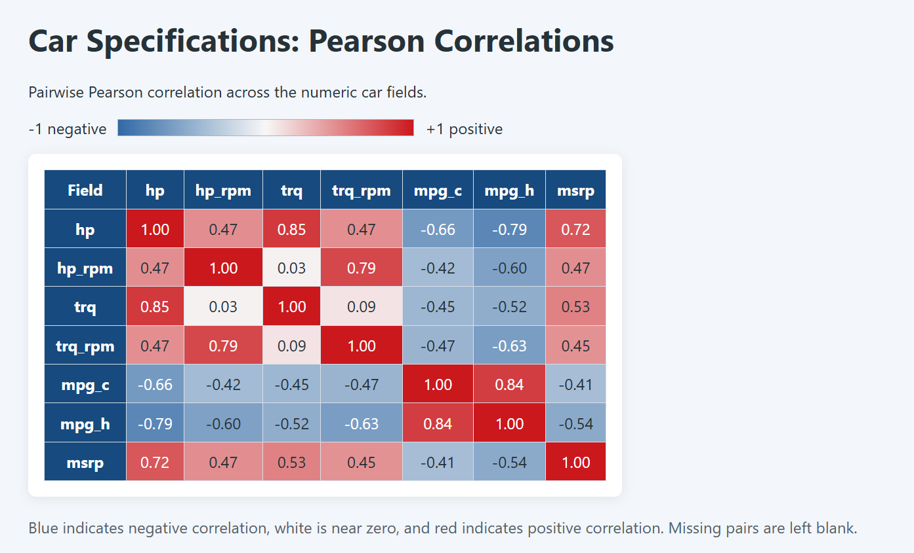

# Dataset files

- `input/day.csv` and `input/hour.csv` are the UCI Bike Sharing dataset CSVs.
- Use `day.csv` for smaller interactive tests and `hour.csv` for larger tests.
- `input/sza.csv` contains solar zenith angle measurements for heatmap-style
  color-scale demonstrations.
- `input/gtcars.csv` is the full 47-car source dataset. Use
  `input/gtcars-numeric.csv` with the current typed-table command-line tool;
  it contains the seven numeric columns used for a correlation heatmap.
- Put generated exports and other test results in `output/`; its contents are
  ignored by Git so test runs do not add generated files to the repository.
- From the repository root, build the real-dataset tool:

  ```powershell
  cmake --build build --config Debug --target dataset_example
  ```

  Then choose an operation:

  ```powershell
  # Sort by cnt, highest first; column defaults to cnt.
  .\build\examples\Debug\dataset_example.exe sort data\input\day.csv data\output\day-sorted.csv

  # Keep only spring records (season == 1).
  .\build\examples\Debug\dataset_example.exe filter data\input\day.csv data\output\spring.csv season 1

  # Export the original dataset as CSV or a complete HTML document.
  .\build\examples\Debug\dataset_example.exe export data\input\day.csv data\output\day-copy.csv
  .\build\examples\Debug\dataset_example.exe export data\input\day.csv data\output\day.html

  # Format a readable preview in the console (20 rows by default).
  .\build\examples\Debug\dataset_example.exe format data\input\day.csv 10

  # Format the first 10 rows and also export those rows as a styled HTML table.
  .\build\examples\Debug\dataset_example.exe format data\input\day.csv 10 data\output\day-first-10.html
  Start-Process .\data\output\day-first-10.html

  # Group and count records by season.
  .\build\examples\Debug\dataset_example.exe group data\input\hour.csv season

  # Create a report-ready analysis: filter to 2012, group by season,
  # calculate rental-count statistics, and sort by total rentals descending.
  .\build\examples\Debug\dataset_example.exe summary data\input\day.csv reports\visuals\bike-sharing-season-summary.html

  # Filter solar angles to latitude 20, group and aggregate by month,
  # then sort by average angle and export an HTML table.
  .\build\examples\Debug\dataset_example.exe sza-summary data\input\sza.csv reports\visuals\solar-zenith-summary.html 20
  Start-Process .\reports\visuals\solar-zenith-summary.html

  # Export a browser heatmap with a yellow-to-purple scale for SZA values.
  .\build\examples\Debug\dataset_example.exe sza-heatmap data\input\sza.csv reports\visuals\solar-zenith-heatmap.html 20
  Start-Process .\reports\visuals\solar-zenith-heatmap.html

  # Export the car numeric correlation matrix with a blue-white-red scale.
  .\build\examples\Debug\dataset_example.exe correlation-heatmap data\input\gtcars-numeric.csv reports\visuals\gtcars-correlation-heatmap.html

  # Export daily average rentals by month and year.
  .\build\examples\Debug\dataset_example.exe bike-heatmap data\input\day.csv reports\visuals\bike-day-heatmap.html

  # Export hourly average rentals by hour and season.
  .\build\examples\Debug\dataset_example.exe bike-heatmap data\input\hour.csv reports\visuals\bike-hour-heatmap.html
  ```

  Replace `day.csv` with `hour.csv` to use the larger hourly dataset. Column
  names are taken from the CSV header. Filter values must match the column's
  type (for example, `season 1` or `dteday 2011-01-01`). Use `Release` instead
  of `Debug` in the executable path if you build the Release configuration.
  For `format`, provide the row count before the optional HTML path. The HTML
  file contains the same first rows displayed by the terminal preview.
  The summary maps season codes 1–4 to Spring, Summer, Fall and Winter, and
  reports the day count plus total, average, minimum and maximum rentals for
  each season in 2012.
  The `sza-summary` command defaults to latitude 20 and shows valid
  observations, average, minimum and maximum solar zenith angle by month.
  Supply another latitude as the final argument to select a different one.
  The `sza-heatmap` command creates a month-by-time HTML heatmap with values
  colored from yellow (low angle) to purple (high angle); it defaults to
  latitude 20.
  `correlation-heatmap` calculates pairwise Pearson correlations and colors
  negative values blue, near-zero values white and positive values red.
  `bike-heatmap` groups daily rental counts by month and year, or hourly
  rental counts by hour and season, then colors the averages from lower to
  higher.

## Generate and capture the color-coded browser tables

From the repository root, build once and generate all three additional
heatmaps (the solar heatmap is included as a fourth command):

```powershell
cmake --build build --config Debug --target dataset_example

.\build\examples\Debug\dataset_example.exe correlation-heatmap data\input\gtcars-numeric.csv reports\visuals\gtcars-correlation-heatmap.html
.\build\examples\Debug\dataset_example.exe bike-heatmap data\input\day.csv reports\visuals\bike-day-heatmap.html
.\build\examples\Debug\dataset_example.exe bike-heatmap data\input\hour.csv reports\visuals\bike-hour-heatmap.html
.\build\examples\Debug\dataset_example.exe sza-heatmap data\input\sza.csv reports\visuals\solar-zenith-heatmap.html 20
```

Use this PowerShell function to open any generated page directly in Chrome.
Paste the function once per PowerShell window, then call it with an HTML path:

```powershell
function Open-DataTableHtmlInChrome {
    param([Parameter(Mandatory = $true)][string]$HtmlPath)

    $resolvedHtml = (Resolve-Path -LiteralPath $HtmlPath).Path
    $chromeCommand = Get-Command chrome.exe -ErrorAction SilentlyContinue
    $chromePath = $null
    if ($chromeCommand) {
        $chromePath = $chromeCommand.Source
    }
    else {
        $candidates = @(
            "$env:ProgramFiles\Google\Chrome\Application\chrome.exe",
            "${env:ProgramFiles(x86)}\Google\Chrome\Application\chrome.exe",
            "$env:LOCALAPPDATA\Google\Chrome\Application\chrome.exe"
        )
        foreach ($candidate in $candidates) {
            if (Test-Path -LiteralPath $candidate) {
                $chromePath = $candidate
                break
            }
        }
    }

    if (-not $chromePath) {
        Write-Warning "Chrome was not found; opening the HTML file in your default browser."
        Start-Process -FilePath $resolvedHtml
        return
    }
    Start-Process -FilePath $chromePath -ArgumentList "`"$resolvedHtml`""
}

Open-DataTableHtmlInChrome reports\visuals\gtcars-correlation-heatmap.html
# Call the same function with another generated HTML file as needed.
```

In Chrome, press **Windows + Shift + S**, select the heatmap, and save each
PNG into `exported-images-examples` using the matching filename below. The
day, hour, and solar heatmaps are split into top and bottom screenshots so the
full tables are readable.

| HTML page | Screenshot filename(s) |
|---|---|
| `bike-day-heatmap.html` | `bike-day-heatmap-top.png`, `bike-day-heatmap-bottom.png` |
| `bike-hour-heatmap.html` | `bike-hour-heatmap-top.png`, `bike-hour-heatmap-bottom.png` |
| `solar-zenith-heatmap.html` | `solar-zenith-heatmap-top.png`, `solar-zenith-heatmap-bottom.png` |
| `gtcars-correlation-heatmap.html` | `gtcars-correlation-heatmap.png` |

To also include a screenshot in the report visuals folder, copy it after saving:

```powershell
Copy-Item exported-images-examples\gtcars-correlation-heatmap.png reports\visuals\
```

Repeat with the chosen screenshot filename. Add the PNGs to the report with
Markdown image links, for example:

```markdown

```

## Heatmap example datasets

The screenshots that inspired the heatmap idea use two datasets from the
[`gt` package](https://github.com/rstudio/gt), which is licensed under MIT:

- [`sza.csv`](https://raw.githubusercontent.com/rstudio/gt/master/data-raw/sza.csv)
  has 816 rows with latitude, month, true solar time and solar zenith angle.
  The corresponding [`sza` documentation](https://gt.rstudio.com/reference/sza.html)
  describes the data and its 4 northern-hemisphere latitudes. The screenshot's
  solar-angle table uses the 20-degree latitude values. Source `NA` values
  are empty in our local CSV because the DataTable loader treats empty CSV
  fields as null. The time labels use `HH:MM` so they remain text in the
  current type-inferencing loader.
- [`gtcars.csv`](https://raw.githubusercontent.com/rstudio/gt/master/data-raw/gtcars.csv)
  has 47 cars and 15 descriptive and specification fields. The correlation
  heatmap is calculated from numeric fields in this dataset; it is not itself
  a separate raw dataset. `gtcars-numeric.csv` is a seven-column numeric
  projection (`hp`, `hp_rpm`, `trq`, `trq_rpm`, `mpg_c`, `mpg_h`, and `msrp`)
  to make the values usable with this project's current typed CSV loader.
  The full CSV includes numeric-only model names such as `911`, which the
  current loader interprets as numbers and rejects in a text column.

The local `sza.csv` and `gtcars.csv` files are adapted from those source CSVs
only to represent missing values as empty cells; `sza.csv` also uses `HH:MM`
time labels, and `gtcars-numeric.csv` is a derived column subset. Keep the
source links and attribution when redistributing these datasets.

The tool normalizes integer-looking values to decimal notation in numeric
columns that also contain decimal values. This compatibility step happens in
memory; it does not change the downloaded source CSVs. The core CSV loader
continues to reject mixed non-null cell types.

The CSV files were downloaded from the
[UCI Bike Sharing dataset](https://archive.ics.uci.edu/dataset/275/bike+sharing+dataset).
The library reads local CSV streams; it does not download URLs or open ZIP
archives itself.
