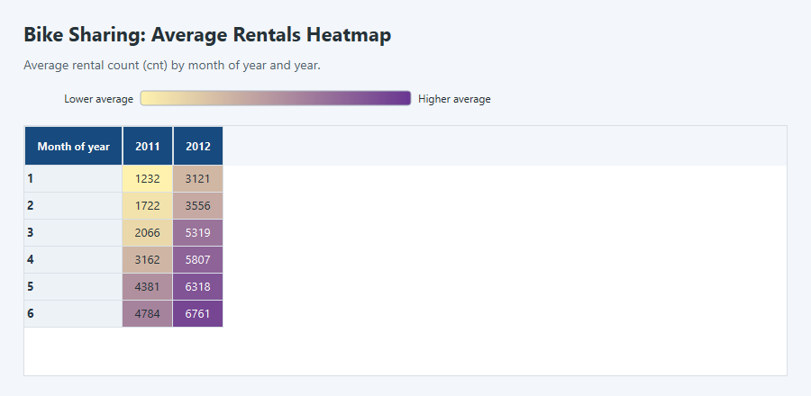
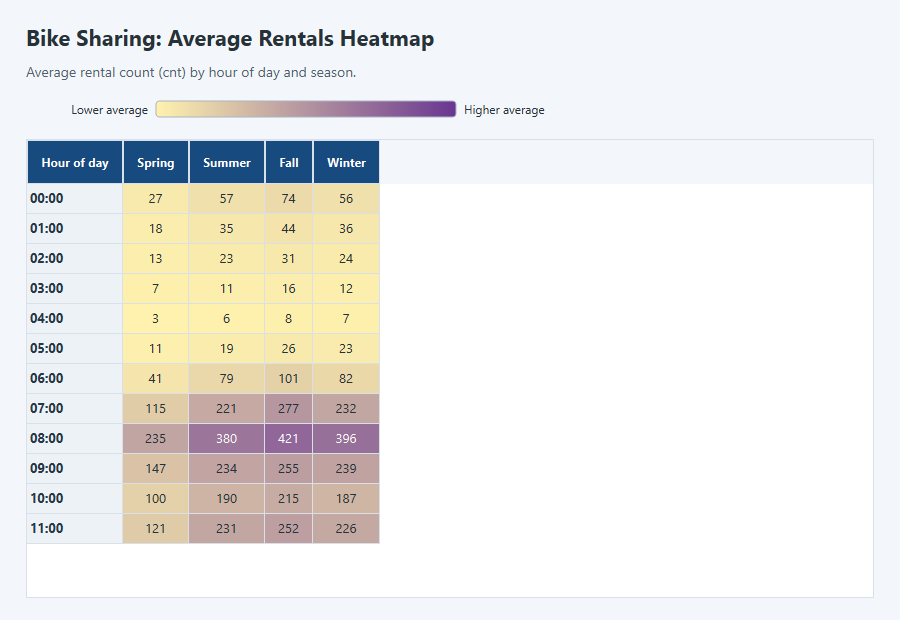
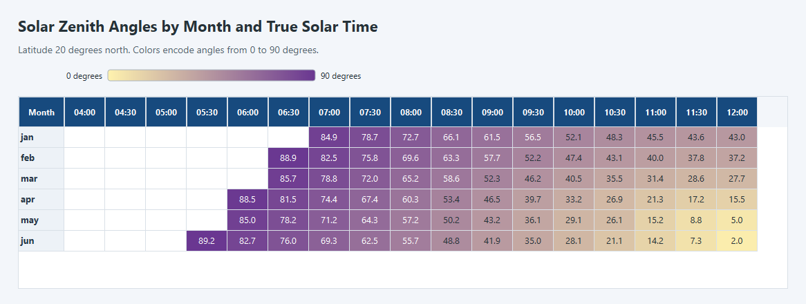
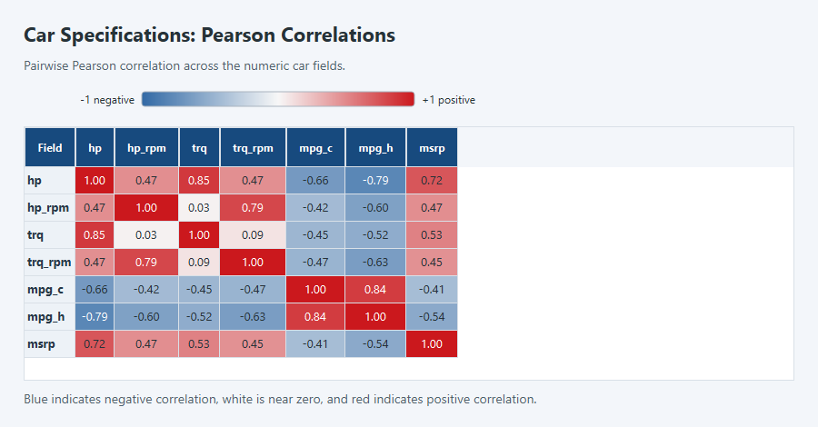
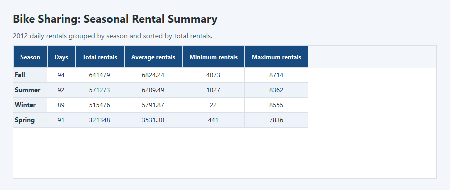
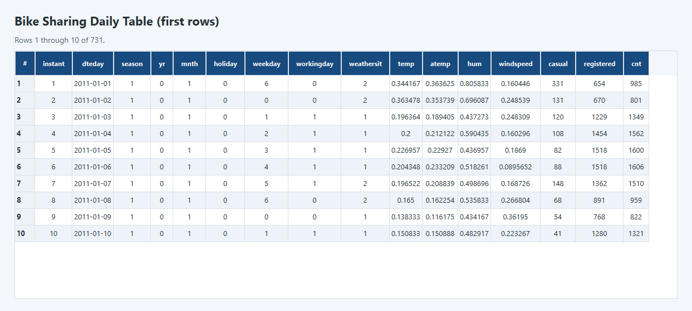

# DataTable — General Project Report

## Executive summary

DataTable is a C++17 library for storing and presenting tabular data through one
shared `DataTable` representation. The implemented project includes typed cells,
rows and columns; table mutation; CSV input; sorting, filtering, grouping and
aggregation; formatting and styling; CSV output; examples; tests; and
CMake installation support.

The integration pass made the table model enforce homogeneous non-null column
types, added checked row update/removal operations, preserved type information
in transformation results, and made assertion-based checks run in Release
tests. A clean MSVC Release configure/build and a Debug validation both passed
the full CTest suite: 19 of 19 tests. The Release installation step also
produced the public headers and CMake package files.

## Project scope

The project was developed as a modular team assignment. Each module shares the
central `DataTable` model rather than introducing a separate table
representation. The public API and behavior described below reflect the
implementation present in this repository and the validation completed for
this report.

## Implemented features

### Data model and table integration

- `Cell` represents null, boolean, signed integer, unsigned integer, floating
  point (`double`) and string values.
- `Row` owns an ordered sequence of cells.
- `Column` owns a name and ordered cell values; it can infer its type from its
  first non-null value or be declared with an explicit type.
- A column accepts null cells, but all non-null values must have the same
  `CellType`. There is no implicit numeric conversion or promotion. Declaring
  `CellType::null` as a column type is invalid.
- `DataTable` maintains row-oriented and column-oriented views of the same
  records. Its public table accessors are read-only; updates go through checked
  operations so the two views remain synchronized.
- Rows can be added, updated, removed, or replaced. Invalid widths and type
  mismatches are rejected; invalid indexes raise `std::out_of_range`.
- Clearing an inferred column or filtering/sorting it to an empty result
  retains known type information.

### Input, transformations and aggregation

- CSV parsing supports quoted fields and escaped quotes, reports malformed
  quoting and inconsistent row widths, and represents missing fields as null.
- CSV records can be loaded into a typed `DataTable` through the public
  `fromCsv` API.
- Sorting supports ascending and descending order and preserves the relative
  order of equal keys. Sorting a table moves complete rows, not detached
  column values.
- Filtering supports predicates and equality checks for a column or complete
  rows. Filtered results preserve the source schema and known column types.
- Grouping consolidates duplicate keys and retains first-seen key order.
- Aggregation provides non-null count and numeric sum, mean, minimum and
  maximum. Numeric aggregations reject non-numeric values; mean, minimum and
  maximum reject an empty set of non-null numeric values.

### Presentation and export

- Formatting supports table and column output, computed widths, header
  visibility, alignment, padding, borders, decimal precision and optional
  footer rows.
- Footer width is validated against the table schema. Formatting reads data
  without changing the underlying table.
- CSV export writes headers and complete rows with field escaping.
- Native Qt provides the desktop table viewer and color-coded presentation
  for the supplied CSV datasets.
- Seven executable examples demonstrate table creation, CSV, filtering,
  grouping, export, integration and a performance sample.

### Bike Sharing dataset analysis

The dataset example also creates a compact report table from `day.csv`. It
filters the records to 2012 (`yr == 1`), groups the remaining rows by season,
calculates the number of days and the total, average, minimum and maximum daily
rentals (`cnt`) for each season, then sorts seasons by total rentals in
descending order. The average is displayed to two decimal places.

The `dataset_example summary` command writes this result as CSV, which can be
opened in the native Qt viewer described in [data/README.md](../data/README.md).

The optional native Qt viewer opens `sza.csv`, `gtcars-numeric.csv`, `day.csv`,
and `hour.csv` directly as desktop tables. It colors numeric cells from lower
to higher values independently within each column. The viewer can also open
CSV summaries produced by `dataset_example` and applies a numeric color scale
within each column.

| Season | Days | Total rentals | Average rentals | Minimum rentals | Maximum rentals |
|---|---:|---:|---:|---:|---:|
| Fall | 94 | 641,479 | 6,824.24 | 4,073 | 8,714 |
| Summer | 92 | 571,273 | 6,209.49 | 1,027 | 8,362 |
| Winter | 89 | 515,476 | 5,791.87 | 22 | 8,555 |
| Spring | 91 | 321,348 | 3,531.30 | 441 | 7,836 |

### Native Qt visualization

The native Qt application is the supported route for viewing the supplied CSV
datasets. Follow the configure, build, and run commands in
[data/README.md](../data/README.md); pass a CSV path to display it, or omit the
path to run the live table-and-graph demonstration. Qt applies a sequential
color scale to numeric values in each column.

The Qt `--render` modes also recreate the earlier project visuals as PNGs
without using a browser:

| Qt visual | Generated image |
|---|---|
| Daily Bike Sharing heatmap |  |
| Hourly Bike Sharing heatmap |  |
| Solar zenith heatmap |  |
| Car correlation heatmap |  |
| Seasonal rental summary |  |
| Formatted daily table |  |

## Architecture

The central model owns the schema and synchronized row/column views:

```text
DataTable
├── Row
│   └── Cell
└── Column
    └── Cell
```

CSV input and the transformation modules work with that model. Formatting and
export are presentation operations and do not mutate the table. Type checks are
applied at column construction, append/update, table row insertion/update and
row replacement boundaries.

## Team module map

The following maps the assignment ownership to the delivered public module
surfaces; it is not a claim about individual Git authorship, which was not
independently audited.

| Contributor | Assigned module | Delivered surface |
|---|---|---|
| Mukhaye Primah | Data model | `Cell`, `Column` and `Row` types and validation |
| Manige Daniel | CSV / data I/O | CSV parsing and typed table loading |
| Nantale Swabrah | Sorting and filtering | Stable sort and predicate/equality filters |
| Alele Brian Jesse | Grouping | Group keys, duplicate consolidation and counts |
| Mwanje Hamuza Tendo | Aggregation | Count, sum, mean, minimum and maximum |
| Tushabe Paul | Formatting and styling | Table/column formatting and style controls |
| Waran Newton Mono Korsuk | Export and examples | CSV export and executable usage examples |
| Bifandhuba Elisha Alvin | Central table / integration | Shared `DataTable`, row operations and integration/build surfaces |

## Verification

Validation was performed locally on Windows with MSVC using CMake. Both Debug
and clean Release configurations enabled tests and examples.

```powershell
cmake -S . -B build -DCMAKE_BUILD_TYPE=Release `
  -DDATATABLE_BUILD_TESTS=ON -DDATATABLE_BUILD_EXAMPLES=ON
cmake --build build --config Release --parallel 2
ctest --test-dir build -C Release --output-on-failure
cmake --install build --config Release --prefix install
```

**Results**

- Clean Release configure and build: passed.
- Release CTest: 19/19 passed.
- Debug CTest: 19/19 passed.
- The project owner confirmed that all tests passed while testing the project
  on a second machine. Its operating system, compiler, build configuration and
  test log were not provided, so the result is user-reported and was not
  independently verified in this workspace.
- CTest coverage comprises 12 module test programs and 7 executable-example
  smoke tests.
- Test assertions remain enabled in Release builds; the test support header
  undefines `NDEBUG` before including `<cassert>`.
- CMake installation completed. The installed public table header and
  `DataTableConfig.cmake` package configuration were verified at the install
  prefix.
- The repository's GitHub Actions workflow was configured to enable tests and
  examples. A remote CI run was not performed as part of this validation.

### Performance sample

The Release performance example loads generated CSV data and measures load,
filter, sort, group, mean and CSV export at three input sizes.
Observed single-run times on the local Windows/MSVC environment are below.
These are illustrative timings, not a controlled benchmark or a
machine-independent performance guarantee.

| Rows | CSV load | Filter | Sort | Group | Mean | CSV export |
|---:|---:|---:|---:|---:|---:|---:|
| 1,000 | 1,349 µs | 168 µs | 261 µs | 17 µs | 8 µs | 1,018 µs |
| 10,000 | 13,224 µs | 2,249 µs | 4,682 µs | 156 µs | 80 µs | 9,296 µs |
| 100,000 | 136,306 µs | 18,495 µs | 51,534 µs | 2,071 µs | 859 µs | 99,473 µs |

The sample uses two grouping keys. The grouping implementation retains
first-seen order by searching existing groups, so grouping is worst-case
`O(n × g)` for `n` input values and `g` distinct groups. Sorting is
`O(n log n)` comparisons. Filtering and aggregation scan their input; table
filtering can copy up to `n` rows of `c` cells (`O(n × c)` in the worst case).
Numeric aggregation is `O(n)`, while formatting and export process the cells
they render (`O(n × c)` apart from value-to-text costs).

## Known constraints

- Columns are homogeneous by non-null value type. Mixed non-null types in one
  CSV column are rejected rather than coerced.
- Numeric aggregation returns `double`; very large integer values may therefore
  lose integer precision during arithmetic.
- Grouping favors deterministic first-seen order over hash-based grouping and
  can take `O(n × g)` time for many distinct keys.
- The performance numbers are a single local sample, without repeated trials,
  warm-up control or comparisons against other libraries.
- The completed build and tests establish local Windows/MSVC behavior. Other
  operating systems and compilers were not exercised in this validation.
- No remote CI run, release publication, pull request, commit-history audit or
  team presentation delivery was verified. The separate
  [final presentation outline](./Final-Presentation.md) is provided as a
  presentation-ready content draft.

## Conclusion

The documented library modules, shared table integration, examples, tests and
install rules are implemented and passed the local Debug and clean Release
checks. The strongest integration result is consistent type enforcement across
the row/column representations without losing type metadata in transformed
results. 

## AI-use declaration

AI assistance was used during repository analysis, implementation, test
updates, validation . The repository's existing APIs and test/build outputs were used to ground the changes and claims.